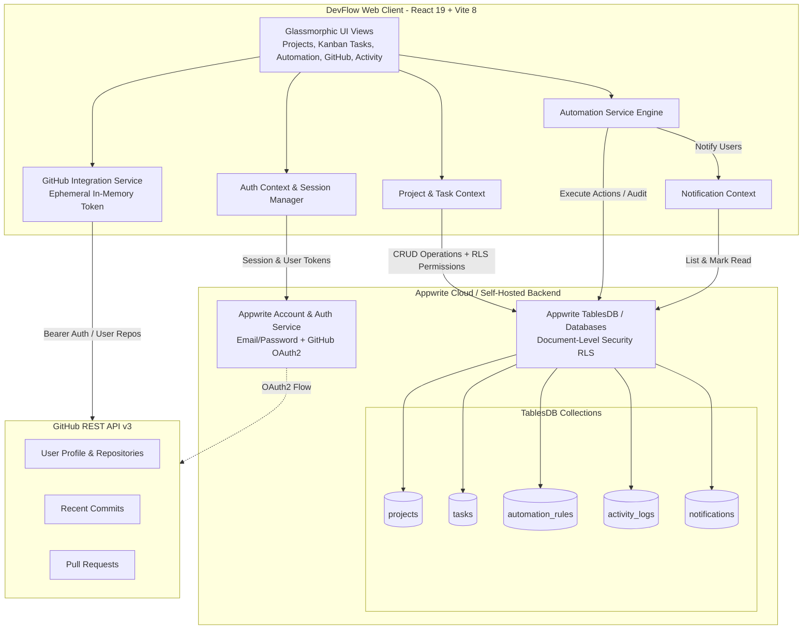
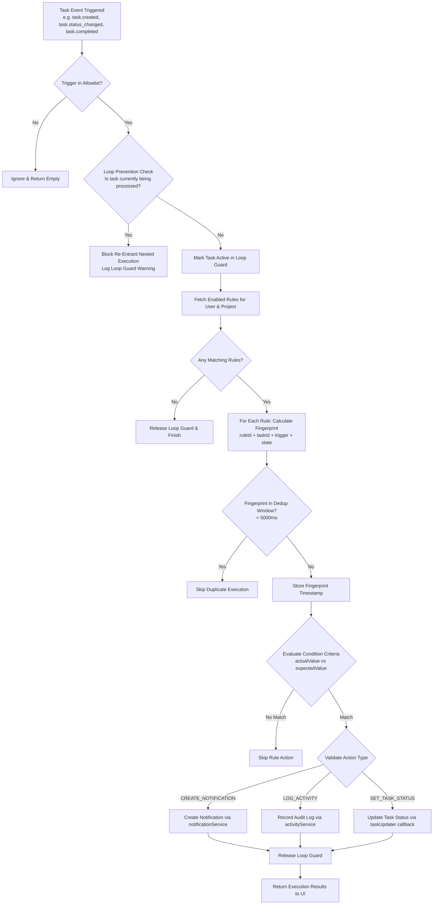

# DevFlow — Developer Workflow & Automation Hub

[](https://github.com/parthbansal9352-hue/DevFlow-Developer-Workflow-Automation-Hub)
[](https://react.dev)
[](https://vite.dev)
[](https://appwrite.io)
[](https://tailwindcss.com)
[](LICENSE)

> **DevFlow** is an intelligent, developer-centric workflow orchestration hub that unifies project management, task tracking (Kanban & List), live GitHub repository activity, and an event-driven automation rules engine with per-user Row-Level Security (RLS) powered by **Appwrite TablesDB**.

---

## 🌟 Key Highlights & Real Implementations

* **True Appwrite TablesDB Integration:** Uses Appwrite TablesDB as the primary persistent data store with automatic fallback to Databases Collections. All operations use real database records with **zero mock data substitutes**.
* **Row-Level Security (RLS):** All data documents (`projects`, `tasks`, `automation_rules`, `activity_logs`, `notifications`) enforce per-user document security permissions (`Permission.read(Role.user(userId))`, `update`, `delete`). Users can never access or mutate another tenant's records.
* **Deterministic Automation Engine:** Implements a testable WHEN / IF / THEN automation engine:
  * **Triggers:** `task.created`, `task.status_changed`, `task.completed`.
  * **Evaluator:** Validated criteria comparison (`EQUALS`, `NOT_EQUALS`, `CONTAINS`) against task fields (`status`, `priority`, `assignee`).
  * **Actions:** In-app notification creation, activity audit logging, and automated task status updates.
  * **Safety Guarantees:** 5-second fingerprint-based deduplication window, re-entrancy recursion guard to eliminate infinite loops, and strict allowlist enforcement (no `eval` or arbitrary JavaScript execution).
* **Secure GitHub Integration:**
  * Connects through Appwrite Server-managed OAuth2 sessions (`account.createOAuth2Session`).
  * **Ephemeral Credentials:** OAuth access tokens exist only in volatile JavaScript RAM during the active session. Tokens are **never** stored in `localStorage`, `sessionStorage`, cookies, `VITE_` variables, or database records.
  * Inspects authorized user repositories, recent commits (short SHA, author, date), and pull requests (number, state, author).
  * Direct bidirectional linking and unlinking between GitHub repositories and DevFlow projects.
* **Audit Trail & In-App Notifications:** Real-time badge counter, mark-as-read controls, and an immutable activity audit log tracking every user mutation and automation trigger.
* **Enterprise-Ready Test Suite:** **103 automated tests** across 7 test suites covering unit logic, security permissions, automation evaluation, GitHub API mocks, and end-to-end user journeys.

---

## 🏗️ Architecture & Real Implementation

### System Architecture Diagram



---

## ⚡ Automation Engine Execution Flow



---

## 🗄️ Database Schema & Permissions Specification

All tables reside inside the `devflow_db` database with **Document Security enabled**:

### 1. `projects`
* **Attributes:** `name` (string 128, required), `description` (string 500), `status` (string 32: `active` | `archived`), `ownerId` (string 64, required), `githubRepo` (string 128: `owner/repo`).
* **RLS Permissions:** `read("user:{ownerId}")`, `update("user:{ownerId}")`, `delete("user:{ownerId}")`.

### 2. `tasks`
* **Attributes:** `projectId` (string 64, required), `title` (string 255, required), `description` (string 2000), `status` (string 32: `todo` | `in_progress` | `in_review` | `done`), `priority` (string 32: `low` | `medium` | `high` | `urgent`), `assignee` (string 128), `dueDate` (string 64), `ownerId` (string 64, required).
* **RLS Permissions:** `read("user:{ownerId}")`, `update("user:{ownerId}")`, `delete("user:{ownerId}")`.

### 3. `automation_rules`
* **Attributes:** `name` (string 128, required), `projectId` (string 64), `triggerEvent` (string 64), `conditionField` (string 64), `conditionOperator` (string 32), `conditionValue` (string 128), `actionType` (string 64), `actionPayload` (string 500), `isEnabled` (boolean, default true), `ownerId` (string 64, required).
* **RLS Permissions:** `read("user:{ownerId}")`, `update("user:{ownerId}")`, `delete("user:{ownerId}")`.

### 4. `activity_logs`
* **Attributes:** `projectId` (string 64), `taskId` (string 64), `action` (string 64), `details` (string 1000), `actorId` (string 64), `actorName` (string 128), `ownerId` (string 64, required).
* **RLS Permissions:** `read("user:{ownerId}")`, `create("users")`.

### 5. `notifications`
* **Attributes:** `userId` (string 64, required), `title` (string 128, required), `message` (string 500, required), `type` (string 32: `info` | `warning` | `success` | `alert`), `isRead` (boolean, default false), `link` (string 255).
* **RLS Permissions:** `read("user:{userId}")`, `update("user:{userId}")`, `delete("user:{userId}")`.

---

## 🛠️ Tech Stack

| Layer | Technologies |
|---|---|
| **Frontend Framework** | React 19 (`^19.3.1`), JavaScript (ES2024 Modules) |
| **Bundler & Build Tool** | Vite 8 (`^8.3.4`) with Rolldown chunk-splitting |
| **Styling & Design System** | Tailwind CSS v4, Lucide React icons, Glassmorphism CSS design system |
| **Backend & Cloud Database** | Appwrite Client SDK (`^29.1.0`), Appwrite Account, Appwrite TablesDB / Databases |
| **Authentication** | Appwrite Email & Password Authentication + GitHub OAuth2 Session Provider |
| **Testing Engine** | Vitest (`^5.0.5`), `@testing-library`, Node test environment |
| **Deployment Target** | Vercel (Configured with `vercel.json` SPA rewrites & security headers) |

---

## 📋 Prerequisites & Installation

### Prerequisites
* **Node.js:** v18.0.0 or higher
* **npm:** v9.0.0 or higher
* **Appwrite Instance:** Free account on [Appwrite Cloud](https://cloud.appwrite.io) or self-hosted Appwrite 1.4+

### Installation Steps

1. **Clone the repository:**
   ```bash
   git clone https://github.com/parthbansal9352-hue/DevFlow-Developer-Workflow-Automation-Hub.git
   cd DevFlow-Developer-Workflow-Automation-Hub
   ```

2. **Install project dependencies:**
   ```bash
   npm install
   ```

3. **Configure environment variables:**
   ```bash
   cp .env.example .env
   ```
   Open `.env` and provide your Appwrite project configuration (see Environment Variables section below).

4. **Initialize database schema (Idempotent Automated Script):**
   ```bash
   node scripts/setup-appwrite-schema.js
   ```

5. **Start local development server:**
   ```bash
   npm run dev
   ```
   Open [http://localhost:5173](http://localhost:5173) in your browser.

---

## 🔐 Environment Variables (`.env.example`)

Copy `.env.example` to `.env`. All client variables must use the `VITE_` prefix:

```env
# Appwrite Server Endpoint (Cloud or self-hosted)
VITE_APPWRITE_ENDPOINT=https://cloud.appwrite.io/v1

# Appwrite Project ID (Found in Appwrite console project settings)
VITE_APPWRITE_PROJECT_ID=your_appwrite_project_id

# Appwrite Database ID
VITE_APPWRITE_DATABASE_ID=devflow_db

# TablesDB / Collections IDs
VITE_APPWRITE_TABLE_PROJECTS=projects
VITE_APPWRITE_TABLE_TASKS=tasks
VITE_APPWRITE_TABLE_AUTOMATION_RULES=automation_rules
VITE_APPWRITE_TABLE_ACTIVITY_LOGS=activity_logs
VITE_APPWRITE_TABLE_NOTIFICATIONS=notifications

# Optional: Default GitHub repository for unauthenticated exploration
VITE_GITHUB_DEFAULT_REPO=facebook/react
```

> **Security Note:** Never place Appwrite Server API Secret Keys or GitHub OAuth Client Secrets in your `.env` file or in frontend code. `.gitignore` strictly blocks all `.env` files from Git commits.

---

## 🐙 GitHub OAuth Setup Guide

1. **Register a GitHub OAuth App:**
   * Go to [GitHub Developer Settings &rarr; OAuth Apps](https://github.com/settings/developers) &rarr; **New OAuth App**.
   * **Application name:** `DevFlow`
   * **Homepage URL:** Your deployed URL or `http://localhost:5173`
   * **Authorization callback URL:**
     ```
     https://cloud.appwrite.io/v1/account/sessions/oauth2/callback/github/{YOUR_APPWRITE_PROJECT_ID}
     ```
   * Save and copy your **Client ID** and **Client Secret**.

2. **Enable GitHub Provider in Appwrite Console:**
   * Navigate to **Auth** &rarr; **Settings** &rarr; **OAuth2 Providers** &rarr; **GitHub**.
   * Toggle **Enabled**, paste the Client ID and Client Secret, and click **Save**.

3. **In DevFlow:**
   * Open the **GitHub Repos** view and click **Connect GitHub**.
   * Upon granting consent, repositories, recent commits, and pull requests will load automatically.

---

## 🧪 Testing & Verification

Run the full automated test suite:

```bash
# Run all unit, integration, and E2E tests
npm test -- --run

# Run code linter
npm run lint

# Run production build
npm run build
```

### Verified Test Results (103 Tests Passing, 0 Failures)

```
Test Files  7 passed (7)
     Tests  103 passed (103)

✓ tests/automationEngine.test.js      (31 tests) - Engine allowlists, dedup, recursion guards
✓ tests/validators.test.js            (24 tests) - Input boundaries, password bounds, regex
✓ tests/securityAndPermissions.test.js (16 tests) - RLS permissions builder, tenant isolation
✓ tests/githubIntegration.test.js     (16 tests) - Rate limits, OAuth session, commits, PRs
✓ tests/automationEvaluator.test.js   (7 tests)  - Condition operators (EQUALS, NOT_EQUALS, CONTAINS)
✓ tests/endToEndJourney.test.js        (6 tests)  - 8-step full user lifecycle + persistence
✓ tests/statsService.test.js          (3 tests)  - Dashboard analytics calculations
```

---

## 🚀 Vercel Production Deployment

1. Push your repository to GitHub:
   ```bash
   git push -u origin main
   ```
2. In your [Vercel Dashboard](https://vercel.com):
   * Click **Add New...** &rarr; **Project**.
   * Import `parthbansal9352-hue/DevFlow-Developer-Workflow-Automation-Hub`.
   * Framework Preset: `Vite` | Root Directory: `./` | Build: `npm run build` | Output: `dist`.
   * Add the required environment variables (`VITE_APPWRITE_ENDPOINT`, `VITE_APPWRITE_PROJECT_ID`, etc.).
   * Click **Deploy**.
3. **Register Vercel Domain in Appwrite:**
   * In **Appwrite Console** &rarr; **Settings** &rarr; **Platforms** &rarr; Add **Web App**.
   * Enter your Vercel hostname (e.g. `*.vercel.app` or your production domain).

---

## 📹 Demo Video & Screenshot Checklist

When recording your 2–3 minute submission demo video, showcase this recommended flow:

- [ ] **1. Authentication (30s):** Sign up as a new developer, show instant dashboard redirection, and demonstrate login persistence.
- [ ] **2. Project & Task Hub (45s):** Create a project, open Kanban board, add tasks across priorities, drag/move task through `todo` &rarr; `in_progress` &rarr; `done`.
- [ ] **3. Automation Engine (45s):** Create an automation rule: `WHEN task.completed IF status == done THEN CREATE_NOTIFICATION`. Move a task to `done`, open Notifications to show the alert, and view the entry in **Activity Logs**.
- [ ] **4. GitHub Integration (45s):** Open **GitHub Repos**, click **Connect GitHub**, showcase repository listing, expand recent commits & pull requests, and link a repository to a project.
- [ ] **5. Access Control (15s):** Log out, show that protected routes require authentication, and demonstrate that data is isolated per user.

---

## 🏁 Hackathon Submission Checklist

Before submitting to the hackathon portal, verify:

* [x] **Public GitHub Repository:** [https://github.com/parthbansal9352-hue/DevFlow-Developer-Workflow-Automation-Hub](https://github.com/parthbansal9352-hue/DevFlow-Developer-Workflow-Automation-Hub)
* [x] **Production Vercel Config:** `vercel.json` with SPA routing and security headers committed.
* [x] **Automated Tests:** All 103 tests passing with 0 failures (`npm test -- --run`).
* [x] **Security Audited:** Zero secrets committed; Row-Level Security active on all collections.
* [ ] **Live Vercel URL:** Insert your live URL after deploying from Vercel dashboard.
* [ ] **Demo Video Link:** Upload your 2–3 minute screen recording (YouTube, Loom, or Vimeo) and paste the link in your submission.
* [ ] **Official Hackathon Rules:** Double-check submission deadlines, team eligibility, and required project fields on the hackathon platform.
